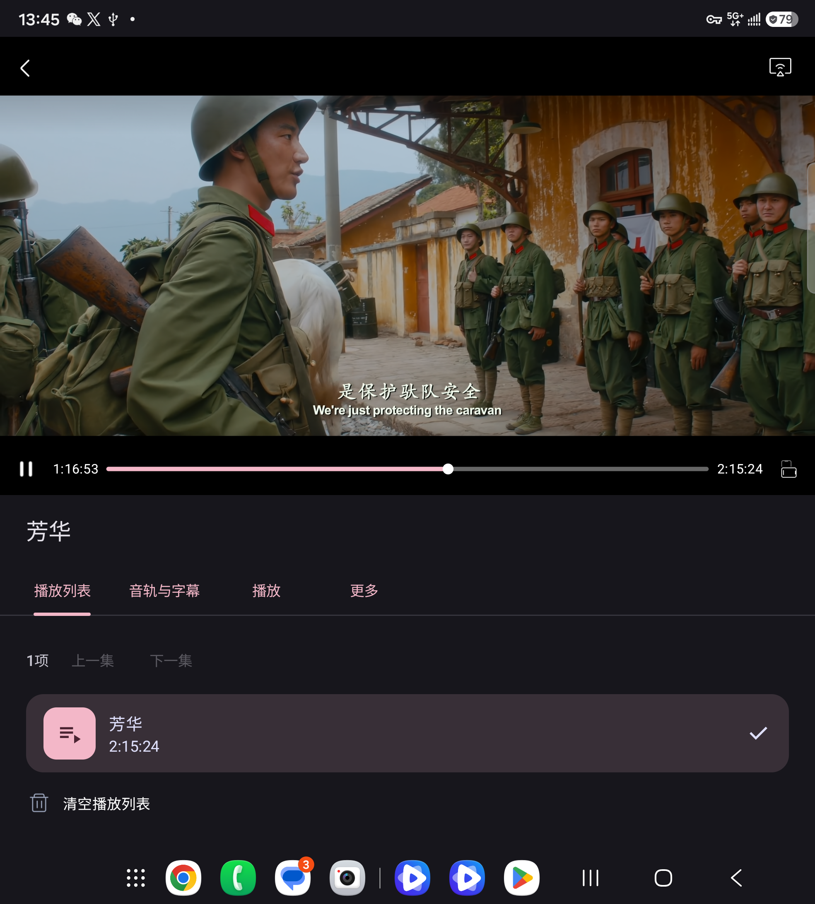
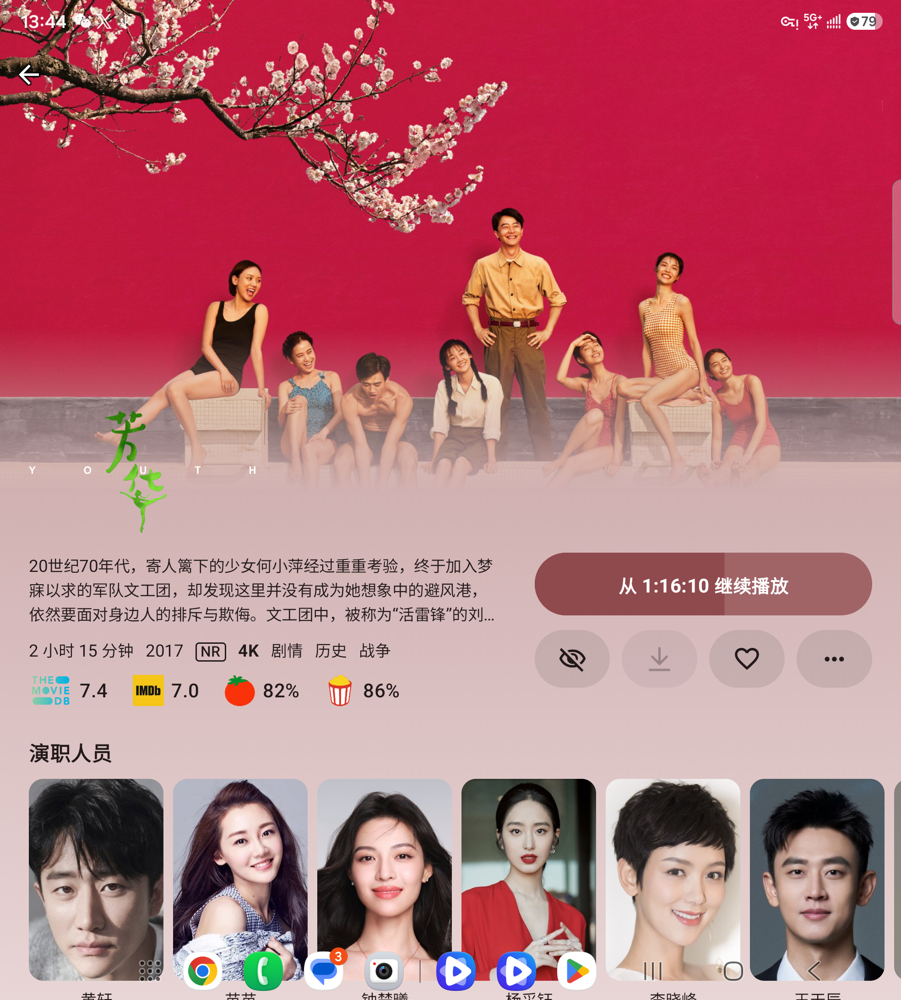
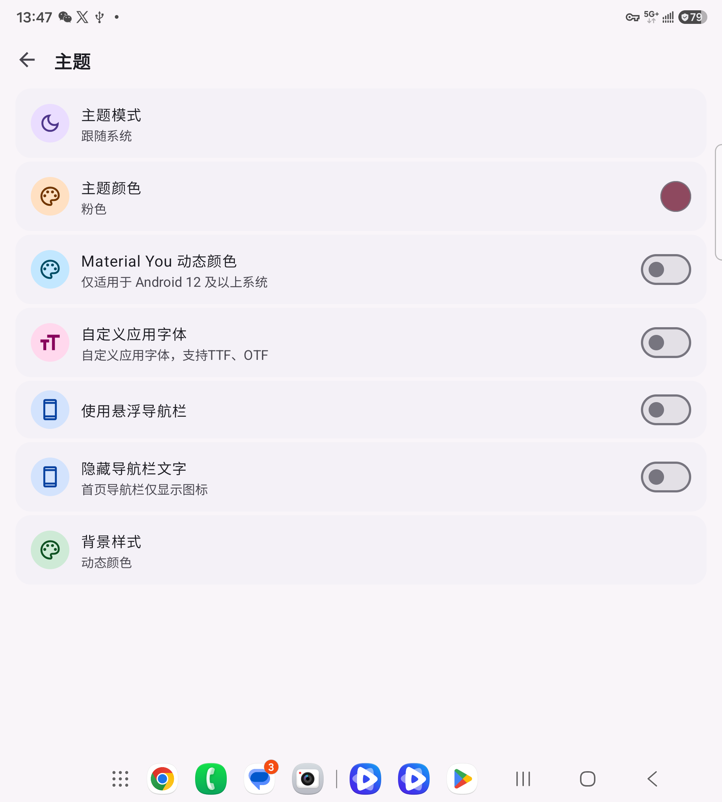
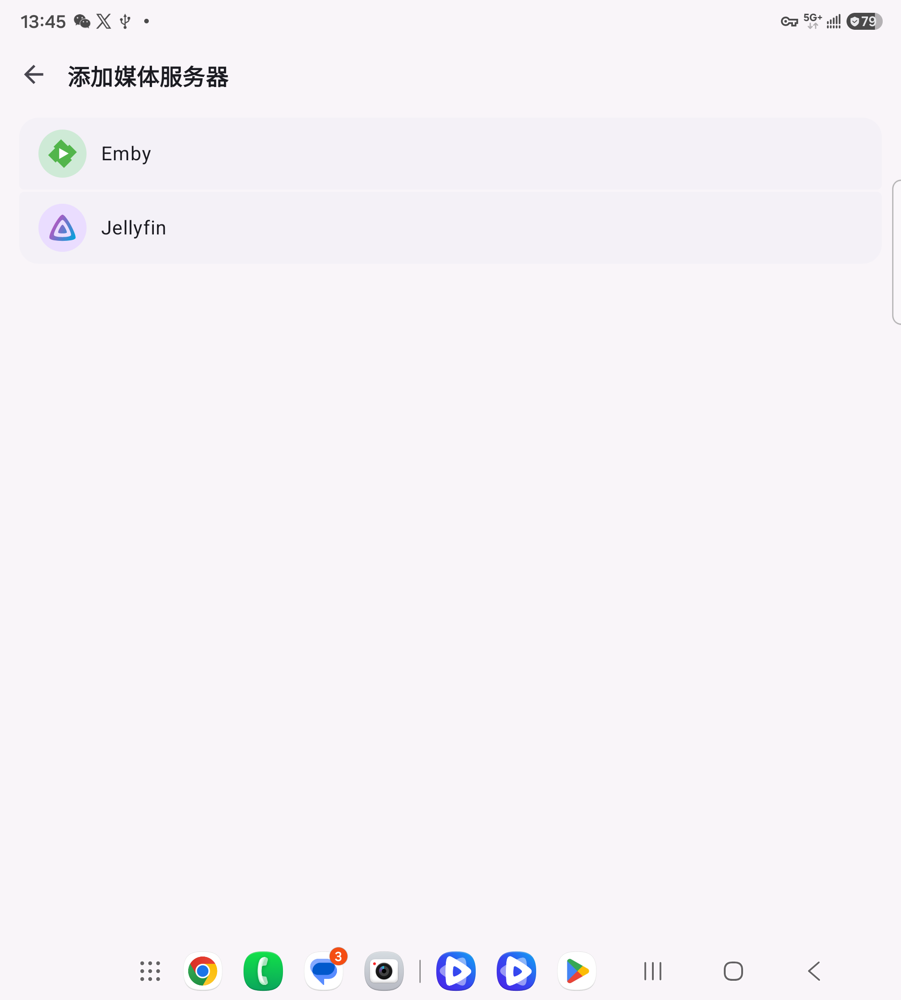

<p align="center"></p>
<h1 align="center">StellarPlayer (Android)</h1>
<p align="center">恒星播放器（Android） · <a href="README.md">简体中文</a> · <a href="LICENSE">GPL-3.0-or-later</a></p>

A native Kotlin / Jetpack Compose media player.

## Features

- Local and network playback with MPV, FFmpeg and libplacebo, using OpenGL for video rendering.
- Subtitles, tracks, playlists, equalizer, picture-in-picture, screenshots and clip export.
- SMB, NFS, WebDAV, Google Drive, OneDrive and your own Emby / Jellyfin libraries.
- Unencrypted DVD / Blu-ray files and images, DVD and HDMV menus.
- Movie, show, season, episode and cast information directly from the official TMDB API.
- Optional aggregate ratings directly from `apiz.trakt.tv`. Episode ratings use the show's IMDb ID plus season and episode numbers.
- DLNA casting through this project's SSDP / SOAP implementation.

## Screenshots

Portrait views on an unfolded foldable display, captured at **1968 × 2184**. Select an image to view it at full size.

### Emby portrait playback

[](assets/screenshots/emby-portrait-playback.png)

### Video details

[](assets/screenshots/video-details.png)

### Theme settings

[](assets/screenshots/settings.png)

### Add a media library

[](assets/screenshots/add-media-library.png)

## Build

The build targets `arm64-v8a` on Android 8.0 / API 26 and later. Native dependencies are built from pinned source archives bundled in this repository.

Requirements: macOS or Linux, JDK 21, Python 3.12+, C/C++ build tools, CMake, pkg-config, Perl, Make and the Android SDK. On Windows, use a Linux / WSL native build environment. Gradle Wrapper, AGP, Kotlin and native source versions are pinned.

```sh
sdkmanager 'platforms;android-37.1' 'build-tools;37.0.0' 'ndk;29.0.14206865' 'cmake;4.1.2'
git clone https://github.com/zzzhr1990/StellarAndroid.git
cd StellarAndroid
cp local.properties.example local.properties
# Edit sdk.dir in local.properties to point to your SDK.
export ANDROID_HOME=/absolute/path/to/Android/sdk
export JAVA_HOME=/absolute/path/to/jdk-21

# macOS example; install equivalent development tools on Linux.
brew install cmake pkg-config python perl
python3 -m venv native/.work/venv
. native/.work/venv/bin/activate
pip install -r native/requirements.txt
python native/build.py
./gradlew :app:assembleDebug
```

The first native build takes time. Source versions and SHA-256 checksums are in [native/sources.json](native/sources.json). Build outputs go to ignored `native/prefix/arm64-v8a`. The native script reads the SDK path from `ANDROID_HOME`.

The debug APK is `app/build/outputs/apk/debug/app-debug.apk`. Release builds are unsigned unless all four signing settings in `local.properties.example` are supplied through local properties or environment variables. Debug uses Android's local default debug keystore. Base versions live in `gradle.properties`; override them with `-PappVersionName=... -PappVersionCode=...`.

## Automated releases

Every push to `release` runs [Android Release](https://github.com/zzzhr1990/StellarAndroid/actions/workflows/release.yml), builds native dependencies from the pinned sources, and publishes a separate [GitHub Release](https://github.com/zzzhr1990/StellarAndroid/releases) containing:

- Signed ARM64 Release APK and AAB. Install the APK directly; the AAB is a distribution bundle.
- Debug APK signed with that run's generated debug key. It cannot upgrade a Release install, and upgrades between debug runs may require uninstalling first.
- The exact repository source archive, including bundled native sources, plus license notices, build metadata and `SHA256SUMS.txt`.

For base version `1.0.0` and workflow run number `42`, the version name is `1.0.0+42`, the tag is `v1.0.0-build.42`, and the version code is `1042` (1000 + run number). Reruns reuse the tag and never overwrite an already public release. Change `appVersionName` in `gradle.properties` for a new base version; preserve the workflow identity and its run-number sequence so Android upgrade version codes keep increasing. Failed builds or verification do not publish a release; all assets are uploaded to a draft before publication.

Required repository Actions Secrets: `ANDROID_KEYSTORE_BASE64`, `ANDROID_KEYSTORE_PASSWORD`, `ANDROID_KEY_ALIAS`, and `ANDROID_KEY_PASSWORD`. Back up the signing key and keep using it for updates. The workflow restores it only in a temporary directory and deletes it after building. Optional service credentials use the same secret names as the environment variables below and default to empty.

```sh
git switch release
git merge main
git push origin release
gh run list --branch release
gh run rerun RUN_ID --failed
```

The workflow lives on the `release` branch and is triggered by new commits. Only `arm64-v8a` is currently supported; ARMv7 / x86 packages are not generated.

## Configure your services

The default configuration supports compilation and local media playback. Optional online service values belong in ignored `local.properties` or environment variables of the same name (environment takes priority):

| Setting | Purpose |
| --- | --- |
| `TMDB_READ_ACCESS_TOKEN` | Your TMDB API Read Access Token (preferred) |
| `TMDB_API_KEY` | Alternatively, your TMDB v3 API key; only one TMDB credential is required |
| `TRAKT_API_KEY` | Your Trakt API client ID for detail ratings |

Supplying the corresponding credentials enables online metadata and ratings. These values are compiled into the APK and can be extracted by its recipients. Provider availability, quotas and authorization rules apply.

Enter your own OAuth access token in the Google Drive or OneDrive connection screen. Use Google Drive `drive.readonly` or Microsoft Graph delegated `Files.Read`, respectively. Obtain a token through the provider's OAuth flow and update it in the connection screen when it expires. Reauthorization verifies the same account/drive identity. Tokens are encrypted locally using Android Keystore.

## License and attribution

Project-owned code is **GPL-3.0-or-later**; see [LICENSE](LICENSE). Third-party components follow their own licenses; trademarks and remotely retrieved data have separate terms. See [THIRD_PARTY_NOTICES.md](THIRD_PARTY_NOTICES.md) for the inventory, source locations and binary distribution obligations.

The README links the [project logo](assets/logo.svg). The Jellyfin mark follows CC BY-SA 4.0. The TMDB mark and remote posters follow the provider's attribution and content terms. Other rating providers use text labels.

This product uses the TMDB API but is not endorsed or certified by TMDB.

TMDB's commercial and non-commercial API terms differ. Obtain your own credentials and follow the [TMDB terms](https://developer.themoviedb.org/docs/faq) and [Trakt terms](https://trakt.tv/terms). See [privacy information](PRIVACY.md).

---

<p align="center">冷湖科技(武汉)有限公司</p>
